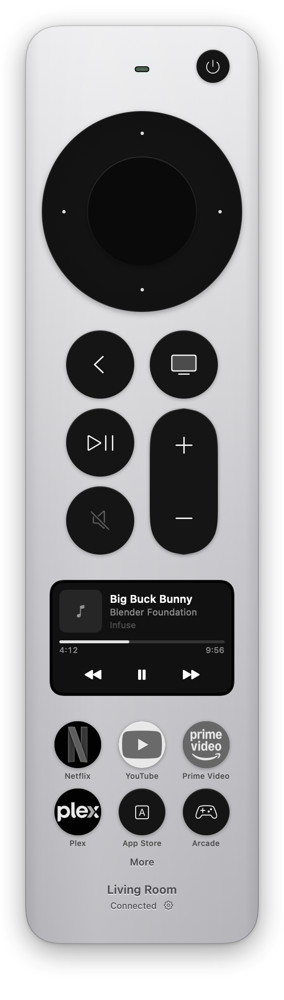
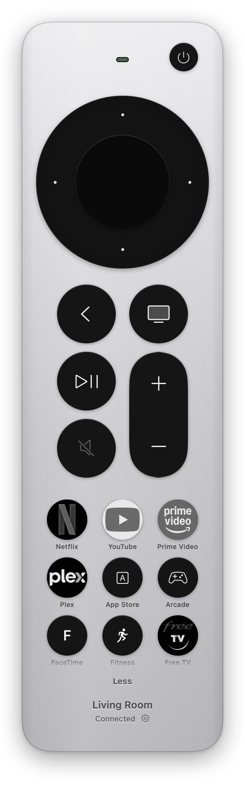
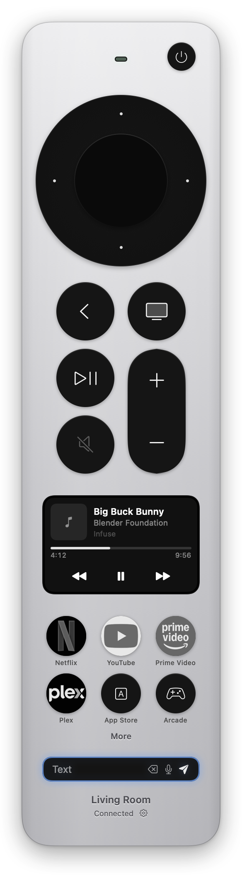
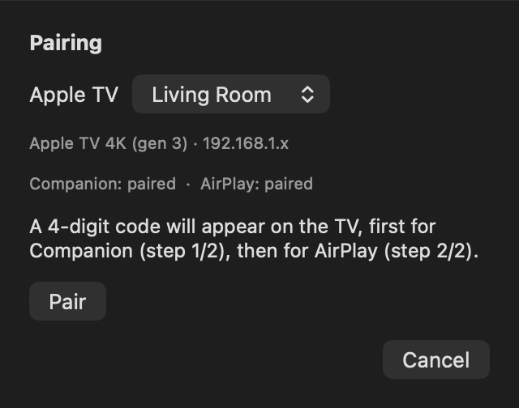

# Apple TV Remote for macOS

A virtual Apple TV remote for your Mac, styled after the aluminium Siri Remote. Native SwiftUI app; the Apple
protocols (Companion / AirPlay, HAP pairing) are handled by [pyatv](https://pyatv.dev).

<p align="center">
  
  &nbsp;
  
  &nbsp;
  
  &nbsp;
  
</p>

## Download

Ready-to-run build (Python and pyatv are bundled, no Xcode or uv needed):
**[latest release on GitHub](https://github.com/Retr0Lovelace/appletv-remote-mac/releases/latest)**.
Requires macOS 15 or later on Apple Silicon.

1. Download **`AppleTVRemote-<version>-macOS-arm64.dmg`** and its `.sha256` file from the Releases page
   (a `.zip` with the same app is also provided).
2. Verify the checksum in Terminal, from the folder containing both files, and check that it prints `OK`:
   ```bash
   shasum -a 256 -c AppleTVRemote-<version>-macOS-arm64.dmg.sha256
   ```
3. Open the `.dmg` and drag **Apple TV Remote** onto the **Applications** shortcut.
4. In Applications, **right-click "Apple TV Remote" → Open** and confirm. The app is ad-hoc signed but **not notarized**
   (no Apple Developer ID), so Gatekeeper asks once.
   Fallback only if right-click → Open does not work: `xattr -dr com.apple.quarantine "/Applications/Apple TV Remote.app"`.
   This disables a macOS safety check, so only do it for a download from the official Releases page whose checksum matched.
5. Grant the permissions macOS asks for:
   - **Local Network** at first launch (System Settings → Privacy & Security → Local Network), to find and control the Apple TV.
   - **Microphone** and **Speech Recognition** on first use of dictation. They are used for dictation only.

Then pair your Apple TV (see [Pairing](#pairing)).

From 1.3.0 on, the app updates itself (see [Automatic updates](#automatic-updates)). **Version 1.2.0 has no updater,
so if you run 1.2.0 you must install 1.3.0 manually once** (steps above); later versions are offered in the app.

## Features

- **Touch pad** like the Siri Remote: drag = swipe, click in the centre = OK, long press = long OK, click on the ring = arrow,
  two-finger scroll on the trackpad = swipe.
- **Buttons**: Back, TV/Home (long press: Control Center), Play/Pause, Mute, Volume ±, power.
- **Installed apps** shown as round buttons with the app logo in black and white. Logos come from the App Store;
  Apple apps use a system symbol. Favourites (Netflix, YouTube, Prime Video...) come first. "More" shows up to 3 scrolling rows.
- **Now playing**: title, artist, app and progress with previous / play-pause / next. Shown only during playback.
  Artwork appears when the Apple TV provides it.
- **Contextual text field**: appears only when a keyboard is active on the TV, prefilled with the TV's current text.
  Type on your Mac and press Return to send it (search, credentials...).
- **On-device dictation (⌘D)**: the microphone button in the text field listens on your Mac and sends the text live to the TV
  without pressing Return. Recognition is strictly on-device (see [Privacy & security](#privacy--security)). It stops after
  about 2 s of silence, on a second click, or when the TV keyboard closes.
- **Transparent window**: only the remote floats on the desktop; drag it by the aluminium. Right-click for settings.
- **Settings** (⚙ menu, right-click, menu bar): open at login, hide the Dock icon (menu-bar-only mode), automatic update checks.
- **Secure self-update**: the app checks GitHub once a day for a new release, downloads it, verifies its Ed25519 signature
  and only then installs it and relaunches ([details](#automatic-updates)).
- **Menu bar icon**: play/pause, volume, mute, sleep/wake.
- **Several Apple TVs**: click the name at the bottom of the remote to switch device.

### Keyboard shortcuts

Inactive while typing in the text field.

| Key | Action |
|---|---|
| Arrow keys | Navigate |
| Return | OK |
| Esc / ⌫ | Back |
| H | Home |
| Space | Play/Pause |
| + / − | Volume |
| ⌘D | Dictation (text field visible) |

## Automatic updates

Release builds check for a newer version 10 seconds after launch, then at most once every 24 hours while running
(⚙ → **Check for updates automatically**, on by default; turn it off there, or use **Check for Updates…** for a manual check).
When a newer release exists a sheet shows the release notes with **Install and Relaunch**, **Later** and **Skip This Version**.

Because the app is ad-hoc signed (no Apple Developer ID), macOS cannot vouch for an update, so the app does it itself:

1. The release `.dmg` must come with a `.dmg.sig` file: an **Ed25519 signature** (like Sparkle's EdDSA) made by the maintainer's
   private key, which never leaves the maintainer's Keychain. The matching public key is embedded in the app.
2. Downloads must use HTTPS from `github.com` (redirects only to `*.githubusercontent.com`), are limited to 300 MB and must match
   the size declared by the release.
3. The signature is checked **before anything is touched**. If it does not verify, the download is deleted and the update is refused;
   there is no "install anyway" option.
4. The image is then mounted read-only and the app inside must have the same bundle identifier, the announced version and a valid
   code signature. It is copied next to the installed app and swapped in atomically by a small helper script after the app quits
   (the old copy is restored if anything fails), then the app relaunches.

Updates are only offered to the release app, and only when its folder is writable (so not from the mounted disk image: move it to
Applications first). Development builds never self-update.

## Pairing

1. Right-click the remote → **Pair…** and choose your Apple TV.
2. **Step 1/2 (Companion)**: enter the 4-digit code shown on the TV.
3. **Step 2/2 (AirPlay)**: enter the second code. This step enables now-playing information.

If pairing is reported as "disabled", on the Apple TV go to Settings → AirPlay and HomeKit → Allow Access and choose
"Anyone on the Same Network".

## Build from source

### Requirements

- macOS 15 or later, Apple Silicon.
- **Xcode** installed: the Command Line Tools alone do not provide the SwiftUI macro plugin that `build.sh` uses.
- [uv](https://docs.astral.sh/uv/) (`brew install uv`). `setup.sh` does not install it for you.

### Steps

```bash
git clone https://github.com/Retr0Lovelace/appletv-remote-mac.git ~/AppleTVRemote
cd ~/AppleTVRemote
./setup.sh     # creates .venv (Python 3.12) and installs the locked, hash-verified dependencies
./build.sh     # builds "build/Apple TV Remote.app" (swiftc, no Xcode project)
open "build/Apple TV Remote.app"
```

The development build runs the Python helper from the project's `.venv` (only if that interpreter is owned by you and
not writable by others). Keep the app in `build/`, or clone the project to `~/AppleTVRemote`, the default location.

To produce the downloadable archive:

```bash
./release.sh   # builds, embeds Python 3.12 + pyatv, ad-hoc signs, writes dist/AppleTVRemote-<version>-macOS-arm64.dmg and .zip, each with a .sha256
```

The version comes from `CFBundleShortVersionString` in `Info.plist`. `release.sh` also signs the dmg with the update key
(see [Maintainers](#maintainers)) and fails if signing fails.

### Locked dependencies

`requirements.in` lists the direct dependencies (`pyatv==0.18.0`, `srptools<2`); `requirements.lock` pins every package
with hashes. Regenerate it with:

```bash
uv pip compile requirements.in --generate-hashes --python-version 3.12 -o requirements.lock
```

`srptools` is kept below 2 because 2.0 breaks pyatv 0.18 pairing.

## Architecture

```
Sources/               SwiftUI app (Swift 6, strict concurrency)
  ATVController        remote state (@MainActor @Observable)
  HelperClient         starts the Python helper, JSON lines over stdin/stdout
  RemoteParts          aluminium body, touch pad, buttons, LED
  IconStore            app logos via the iTunes API, disk cache, black-and-white conversion
  ArtworkDecoder       size-checked now-playing artwork decoding
  Dictation            on-device speech recognition
  Updater, UpdateView  signed self-update (check, download, Ed25519 verification, atomic install)
tools/update-key.swift Ed25519 signing key in the login Keychain (generate / public / sign)
Resources/*.lproj      localizations (en, fr)
helper/atv_helper.py   asyncio helper around pyatv (scan, pairing, keys, swipe, text, apps...)
```

The helper runs with `python -I` and a minimal environment, and only accepts an explicit list of commands.

Manual helper test:

```bash
echo '{"id":1,"cmd":"scan","args":{}}' | .venv/bin/python -I helper/atv_helper.py
```

The screenshots in this README are generated by the app itself (no screen-recording permission needed). Snapshot mode is
disabled unless explicitly enabled:

```bash
ATV_ENABLE_SNAPSHOT=1 SNAPSHOT_DEMO=1 "build/Apple TV Remote.app/Contents/MacOS/AppleTVRemote" --snapshot docs/
# optional env: SNAPSHOT_EXPAND_APPS=1, SNAPSHOT_PAIRING=1, SNAPSHOT_SHOW_TEXT=1, SNAPSHOT_DELAY=10
```

`SNAPSHOT_DEMO=1` replaces the device name, hides IP addresses and shows a fake now-playing state.

## Privacy & security

- **Dictation is on-device only.** If offline recognition is not available for your language, dictation does not start
  (and tells you how to enable it in System Settings → Keyboard → Dictation). No audio is ever stored or sent anywhere.
- **Credentials** (pairing keys) are stored in `~/Library/Application Support/Télécommande Apple TV/pyatv.conf` with
  mode 0600, in a 0700 folder. The folder keeps its original name so existing pairings carry over. A legacy project-root
  `pyatv.conf` is copied there once. Never share this file; it is git-ignored.
- **Network requests**: (1) the local network, to the Apple TV; (2) the iTunes Search API (`https://itunes.apple.com`) to fetch
  app logos, which sends the names / bundle ids of the apps installed on your Apple TV. Only HTTPS is used, artwork
  is accepted only from `*.mzstatic.com`, with size and dimension limits. Nothing else leaves your Mac.
- **Update check**: once a day (and on manual request) the app contacts `api.github.com` (releases API of this repository, no
  identifier is sent beyond a User-Agent with the app version) and, if you install an update, downloads it from `github.com`.
  Updates are verified with an Ed25519 signature before installation (see [Automatic updates](#automatic-updates)).
  Disable the daily check in ⚙ → *Check for updates automatically*.
- The Python helper is launched in isolated mode with a minimal environment. Releases are checksummed but not notarized.

See [SECURITY.md](SECURITY.md) to report a vulnerability.

## Maintainers

### Update signing key

The update key is an Ed25519 key pair. The **private key lives only in the login Keychain** (generic password, service
`com.retr0.appletvremote.update-signing`, account `ed25519`), never in the repository or on disk. The public key is embedded in
the app (`ATVUpdatePublicKey` in `Info.plist`, with a constant fallback in `Sources/Updater.swift`).
`tools/update-key.swift` is compiled on demand by `release.sh`:

```bash
swiftc -O -o build/update-key tools/update-key.swift
build/update-key generate [--force]   # create the key (refuses to overwrite without --force), prints the public key
build/update-key public               # print the base64 public key
build/update-key sign <file>          # print the base64 signature of a file
```

**Back up the key.** Either export it from Keychain Access (search "update-signing"), or print it with
`security find-generic-password -s com.retr0.appletvremote.update-signing -a ed25519 -w` and store it in a password manager
(the output is the secret key material, never paste it anywhere public). If the key is lost or replaced, installed apps reject
every new release, and users must reinstall manually once from the Releases page.

### Releasing

1. Bump `CFBundleShortVersionString` and `CFBundleVersion` in `Info.plist`.
2. `./release.sh` writes to `dist/`: the `.dmg`, `.dmg.sha256`, `.dmg.sig`, `.zip` and `.zip.sha256`.
3. Commit and push, then publish all five files (the updater needs the exact names `AppleTVRemote-<v>-macOS-arm64.dmg` and `.dmg.sig`):
   ```bash
   gh release create vX.Y.Z dist/AppleTVRemote-X.Y.Z-macOS-arm64.{dmg,dmg.sha256,dmg.sig,zip,zip.sha256} \
     --title "Apple TV Remote X.Y.Z" --notes-file notes.md --latest
   ```
   The release must not be a draft or prerelease: the updater ignores those.

### Testing the updater

With `ATV_ENABLE_SNAPSHOT=1`, `ATV_UPDATE_FEED=http://127.0.0.1:<port>/latest.json` points the app at a local fake releases
feed (assets from `http://127.0.0.1` are then accepted) and `ATV_UPDATE_AUTOINSTALL=1` installs without the sheet. These hooks
are ignored otherwise.

## Troubleshooting

- **No Apple TV found**: check that the Mac and the Apple TV are on the same network and that Local Network access is
  granted (System Settings → Privacy & Security → Local Network).
- **"Not paired"**: use Pair… from the right-click menu.
- **Mute is greyed out**: mute works through the volume setting, so the device connected to the Apple TV must accept volume control.
- **Dictation says offline dictation is unavailable**: enable Dictation in System Settings → Keyboard and download your language.
- **Helper problems**: right-click → Restart helper. For development, run `./setup.sh` again.
- To quit from Terminal: `osascript -e 'tell application "Apple TV Remote" to quit'`.

## Localization

The app is available in **English** and **French** (it follows the macOS language). Strings live in
`Resources/en.lproj` and `Resources/fr.lproj` (`Localizable.strings`, `InfoPlist.strings`). To add a language, copy
`en.lproj`, translate the values, and add the language code to `CFBundleLocalizations` in `Info.plist`.

## License

MIT. Personal project, not affiliated with or endorsed by Apple Inc. "Apple TV" and "Siri Remote" are trademarks of Apple Inc.
